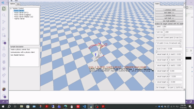

# URDF Graph IK: live demo

Interactive simulation of **URDF-conditioned graph-neural-network inverse kinematics**. The network reads a robot's URDF as a kinematic graph and solves IK for arms it was **never trained on**, with no previous joint state required.

This repository only **runs** the published model. It downloads the `main_1` checkpoint from the Hugging Face Hub and drives the robot live in a PyBullet window.



---

## 1. Requirements

| | |
|---|---|
| Python | **3.10, 3.11 (recommended) or 3.12**. PyBullet has no wheels for 3.13 yet. |
| OS | Linux, Windows or macOS. The live window needs OpenGL; headless recording works anywhere. |
| Hardware | Any CPU; no GPU needed. On a 4-core CPU: ~40 ms per frame while tracking, ~70 ms for a far jump. |
| Disk | ~3 GB for the environment (PyTorch), ~35 MB for the checkpoint |

## 2. Set up the dedicated virtual environment

### Linux / macOS

```bash
git clone https://github.com/<you>/urdf-graph-ik-demo.git
```

```bash
cd urdf-graph-ik-demo
```

```bash
./setup_env.sh
```

On Linux you can use `./setup_env.sh --cpu` instead, for the smaller CPU-only PyTorch wheel. If `python3.11` isn't your default, use `PYTHON=python3.11 ./setup_env.sh`.

```bash
source .venv/bin/activate
```

### Windows (PowerShell)

```powershell
.\setup_env.ps1
```

```powershell
.\.venv\Scripts\Activate.ps1
```

If script execution is blocked, run `Set-ExecutionPolicy -Scope Process Bypass` first.

<details><summary>What the setup script does (manual equivalent)</summary>

```bash
python3.11 -m venv .venv
```

```bash
source .venv/bin/activate
```

```bash
python -m pip install --upgrade pip wheel
```

```bash
pip install -r requirements.txt
```

```bash
python -m graphik_demo selftest
```
</details>

The self-test runs offline. It checks forward kinematics against PyBullet, the IK pipeline, and headless rendering, and must end with `ALL OK`.

## 3. Point the demo at the model

The demo uses exactly one checkpoint: **`experiments/journal_main_s0/model.pt`** in the Hugging Face repo that the training notebook pushed to. Set the repo once, in any of these ways:

- edit `DEFAULT_HF_REPO` in `graphik_demo/config.py` (recommended before publishing), or
- `export GRAPHIK_HF_REPO=<hf-user>/urdf-graph-ik`, or
- pass `--repo <hf-user>/urdf-graph-ik` to any command.

If the Hugging Face repo is **private**, log in once with `hf auth login` (older huggingface_hub: `huggingface-cli login`), or set `HF_TOKEN`. The checkpoint downloads on first use and is cached in `~/.cache/huggingface`.

## 4. Run

```bash
python -m graphik_demo
```

This opens the live simulation window. Other commands:

```bash
python -m graphik_demo list
```
lists the robots with their **SEEN / UNSEEN** status, read from the checkpoint's own training config.

```bash
python -m graphik_demo gui --robot panda --track circle
```
starts on a given robot and track.

```bash
python -m graphik_demo gui --urdf path/to/your_arm.urdf --ee tool0
```
adds any other URDF; it's shown as an UNSEEN robot.

### Controls (right-hand "Params" panel)

| Control | What it does |
|---|---|
| `<< previous robot` / `next robot >>` | switch robot. The HUD shows **SEEN** (in the training set) or **UNSEEN** (held out, or never seen) |
| `<< previous track` / `next track >>` | end-effector track: `figure8`, `circle`, `square`, `line`, `helix`, `random_poses`, `manual` |
| `new track position` | re-place the track elsewhere in the workspace |
| `random far target (solved with NO seed)` | teleports the target; solved from scratch without using the current joints |
| `speed`, `track size` | track speed and size. Tracks are checked for reachability first and shrink if needed |
| `seed with current joints` | 1 = use the current joint state as one candidate, 0 = never (pure learned IK) |
| `DLS polish` | 1 = network + a few damped-least-squares steps (the full method), 0 = network output only |
| `manual target dx/dy/dz/roll/pitch/yaw` | drive the target by hand (track `manual`) |
| `link i length x` + `apply link lengths` | stretch or shrink individual links: an **UNSEEN variant** of the robot (drawn as a stick model) |
| `reset link lengths` | back to the original robot |

**In the 3-D view:**
- **Red line:** the target track.
- **Green trail:** where the end effector actually went.
- **RGB axes:** the target frame.
- **HUD:** live position and rotation error, joint step per frame, and solve time. The error turns red only if a target is outside the workspace (`manual` mode).

### Suggested checks for reviewers

1. **Seen vs. unseen.** Compare a SEEN robot (e.g. `xarm6`) with the held-out `panda`, using the same track.
2. **Changed link lengths.** Set e.g. `link 2 length x = 1.4`, press *apply link lengths*, and keep tracking. There is no retraining.
3. **No reliance on the previous state.** Set `seed with current joints = 0`, or press *random far target*.
4. **What the network does alone.** Set `DLS polish = 0` to see the raw network accuracy.

## 5. Headless recording (no display needed)

```bash
python -m graphik_demo record --robot panda --track figure8 --out videos/panda_figure8.mp4
```

```bash
python -m graphik_demo record --robot xarm6 --track circle --link-scale 1,1,1.35,1.3,1,1,1
```

```bash
python -m graphik_demo record --track helix
```

- The second command records a stretched variant. It takes one value per joint offset plus one for the tool (`list` shows the DOF).
- The third command records every available robot.
- Options: `--no-seed`, `--no-polish`, `--frames N`, `--size S`.

Each run prints a JSON summary (mean and max error, fraction of frames on target, largest joint step, median solve time) and writes an mp4, or a GIF if ffmpeg is missing.

## 6. Industrial robots (ABB / KUKA)

The model was also trained and evaluated on ROS-Industrial URDFs: ABB IRB 2400 / 5400 / 6640 / 6640-185-280 and KUKA KR16-2 / KR120. They aren't redistributed here.
- Copy the `urdf-dataset` folder (the same layout as the Kaggle dataset used for training) to `robots/urdf-dataset/`. They then appear automatically.
- `robots/robots.yaml` lists every robot; add your own there too.
- If a URDF's meshes can't be resolved (`package://` paths), that robot is drawn as a stick model generated from its exact kinematics. The IK is unaffected.

## 7. Repository layout

```
graphik_demo/
  kinematics.py   URDF parsing, kinematic chains, batched differentiable FK  ┐ generated from the training
  model.py        the graph network (proposal + refinement trunks)          │ notebook so the architecture
  solver.py       learned proposals -> learned refinement -> DLS polish     │ matches the checkpoint exactly
  urdf_gen.py     stick-model URDF for any (modified) chain                  ┘
  hub.py          download + rebuild the journal_main_s0 checkpoint
  robots.py       robot registry + SEEN / UNSEEN labels from the checkpoint config
  trajectories.py reachability-checked end-effector tracks
  session.py      per-frame IK session (seed, iteration budget, metrics)
  app_gui.py      PyBullet window with controls and HUD
  record.py       headless mp4 recorder
  selftest.py     offline self-test
robots/robots.yaml
tests/            pytest -q  (offline)
setup_env.sh / setup_env.ps1
```

## 8. Troubleshooting

| Problem | Fix |
|---|---|
| `Failed building wheel for pybullet` | Use Python 3.10–3.12 (`PYTHON=python3.11 ./setup_env.sh`). On macOS, building needs the Xcode command-line tools. |
| `Set the Hugging Face repo first` | See section 3 |
| 401 / 404 on download | Private repo: `hf auth login` (or `huggingface-cli login`). Otherwise check the repo name, and that `experiments/journal_main_s0/model.pt` exists. |
| No window over SSH / WSL / headless server | Use `record` (section 5), or run under `xvfb-run -a python -m graphik_demo` |
| `[text] text encoder unavailable` | Fine: the model was trained with text dropout and runs geometry-only. Use `--no-text` to skip loading it. |

## 9. Tests

```bash
pip install -r requirements-dev.txt
```

```bash
pytest -q
```

## Citation / license

<!-- TODO before publishing: add the paper citation (BibTeX) and choose a license. -->
